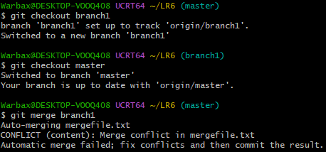
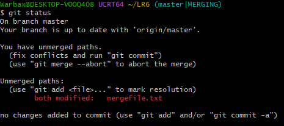
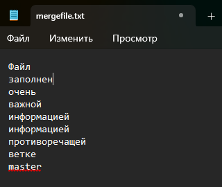
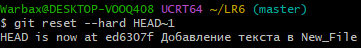

# Лабораторная работа №6
## Выполнил: Буксеев Б.Д.

**Тема:** Система контроля версий Git

**Цель:** изучение базовых возможностей системы управления версиями, получение опыта работы с Git, с локальным и удалённым репозиторием.

## Ход работы

### 1. Создание аккаунта и форк репозитория
После регистрации на GitHub (имя аккаунта – `Warbax404`) был выполнен форк репозитория по ссылке https://github.com/Kurtyanik/LR6/. В профиле появилась папка `Warbax404/LR6`.

### 2. Установка и настройка Git
Далее был установлен Git с сайта https://git-scm.com/. После установки в терминале Git были заданы имя пользователя и почта при помощи команд:
```
git config --global user.name "4515 Буксеев Б.Д."
git config --global user.email "bbukseev@bk.ru"
```
Настройки отображаются корректно, что видно при вводе команды `git config --global --list`  (рис. 1).

<p align="center">
  <br>
  Рисунок 1 — Проверка корректности настроек
</p>

### 3. Копирование репозитория
Форк был скопирован на компьютер, установлена папка репозитория при помощи команд:
```
git clone https://github.com/Warbax404/LR6.git
cd LR6
```

### 4. Создание файла
Создан файл `New_File` и сохранён в главную ветку.
Далее изменения были подтянуты в локальный репозиторий при помощи
```
git pull
```

Далее работа проводилась локально.

### 5. История операций
Была получена история операций (рис. 2-4) и последние изменение (рис. 5) при помощи команд
```
git log master
git log origin/branch1
git show
```

<p align="center">
  <br>
  Рисунок 2 — История операций master
</p>
<p align="center">
  <br>
  Рисунок 3 — История операций master
</p>
<p align="center">
  <br>
  Рисунок 4 — История операций branch1
</p>
<p align="center">
  <br>
  Рисунок 5 — Последние изменения
</p>

### 5. Слияние веток
Локально была установлена ветка branch1, переключение обратно на master:
```
git checkout branch1
git checkout master
```
Далее была выполнена попытка слияния веток при помощи
```
git merge branch1
```
Однако, в терминале появился конфликт (рис. 6).
<p align="center">
  <br>
  Рисунок 6 — Конфликт
</p>

Чтобы узнать, в каком файле конфликт, была введена команда
```
git status
```
В результате конфликт был найден в mergefile.txt (рис. 7).
<p align="center">
  <br>
  Рисунок 7 — Найден проблемный файл
</p>

Далее в приложении Блокнот были удалены маркеры слияния (`<<<<<<< HEAD`, `=======`, `>>>>>>> branch1`) и оставлена информация из обоих файлов (рис. 8).
<p align="center">
  <br>
  Рисунок 8 — Разрешение конфликта
</p>

Затем изменения были зафиксированы и отправлены на GitHub при помощи команд:
```
git add mergefile.txt
git commit -m "Конфликт разрешён"
git push origin master
```
После успешного слияния ветка branch1 была удалена при помощи команды
```
git branch -d branch1
```

### 6. Работа с коммитами
Через Блокнот был отредактирован файл `New_File`. Далее был добавлен новый файл с текстом `New_New_File`. Выполненны коммиты.
```
git add .
git commit -m "Добавление текста в New_File"
echo "Невероятно много изменений" > New_New_File
git add .
git commit -m "Создание New_New_File"
```

Затем был выполнен откат коммита. При этом новый файл удалился.
```
git reset --hard HEAD~1
```
В результате был выполнен откат до коммита `ed6307f` (рис. 9)
<p align="center">
  <br>
  Рисунок 9 — Откат коммита
</p>

### 7. Оформление отчёта
Далее была создана ветка для отчёта `report`. Изначально оформление отчёта было ошибочно начато в ветке `master`. Для переноса файлов в нужную ветку было выполнено слияние.
```
git checkout -b report
git checkout master -- README.md images
git add .
git commit -m "Update README"
```

### 8. Лог команд и история операций
Лог команд и исторяи коммитов были получены при помощи команд:
```
history
git log --pretty=format:"%h | %ad | %an | %s" --date=short
```
В них отсутствуют последний команды, отвечающие за финальную фиксацию из-за того, что это требует бесконечного редактирования файла README, что означает замкнутый круг.

### Лог команд
 1  git config --global user.name "4515 Буксеев Б.Д."
    2  git config --global user.email "bbukseev@bk.ru"
    3  git config --global --list
    4  git clone
    5  git clone https://github.com/Warbax404/LR6.git
    6  cd LR6
    7  git pull
    8  git log master
    9  git log master
   10  cd LR6
   11  git log master
   12  cd LR6
   13  git log branch1
   14  git log branch1
   15  git branch -a
   16  git log origin/branch1
   17  git log --oneline --graph --all
   18  git show
   19  git checkout branch1
   20  git checkout master
   21  git merge branch1
   22  git status
   23  git status
   24  git merge --abort
   25  git checkout master
   26  git merge branch1
   27  git add mergefile.txt
   28  git commit -m "Конфликт разрешён"
   29  git push origin master
   30  git push origin master
   31  git push origin master
   32  git pull
   33  git push origin master
   34  git pull
   35  git pull
   36  git pull
   37  git add mergefile.txt
   38  cd LR6
   39  git commit -m "Конфликт разрешён"
   40  git push origin master
   41  git pull
   42  git branch -d branch1
   43  git push
   44  notepad info.txt
   45  notepad New_File
   46  notepad New_File
   47  git add .
   48  git commit -m "Добавление текста в New_File"
   49  echo "Невероятно много изменений" > New_New_File
   50  git add .
   51  git commit -m "Создание New_New_File"
   52  git revert HEAD
   53  git reset --hard HEAD~1
   54  git add .
   55  git commit -m
   56  git commit -m "Uptade README"
   57  git log --oneline
   58  cd LR6
   59  git checkout -b report
   60  git branch
   61  git checkout report
   62  git add .
   63  git commit -m "Update README"
   64  git checkout master -- README.md images
   65  git add .
   66  git commit -m "Update README"
   67  git push
   68  git push --all origin
   69  git branch -d branch1
   70  git push origin --delete branch1
   71  git add .
   72  git commit -m "Update README"
   73  history

### История операций

47d0a78 | 2026-11-11 | 4515 Буксеев Б.Д. | Update README
71e6b9e | 2026-11-11 | 4515 Буксеев Б.Д. | Update README
39e7f77 | 2026-11-11 | 4515 Буксеев Б.Д. | Update README
32e9891 | 2026-11-11 | 4515 Буксеев Б.Д. | Uptade README
ed6307f | 2026-11-11 | 4515 Буксеев Б.Д. | Добавление текста в New_File
8f0a143 | 2026-11-11 | Warbax404 | Update README.md
37e428d | 2026-11-11 | Warbax404 | Update README.md
d131d28 | 2026-11-11 | 4515 Буксеев Б.Д. | Конфликт разрешён
9b44aa6 | 2026-11-11 | 4515 Буксеев Б.Д. | Merge branch 'master' of https://github.com/Warbax404/LR6
dcd05a5 | 2026-11-11 | Warbax404 | Update README.md
2d2e038 | 2026-11-11 | 4515 Буксеев Б.Д. | Конфликт разрешён
747e5c6 | 2026-11-11 | Warbax404 | Rename image.png to image_8.png
15c03fb | 2026-11-11 | Warbax404 | image 8
e61a314 | 2026-11-11 | Warbax404 | Update README.md
fd479c7 | 2026-11-11 | Warbax404 | Update README.md
4fff7b5 | 2026-11-11 | Warbax404 | Rename image.png to image_7.png
fe09af5 | 2026-11-11 | Warbax404 | image 7
b54b8f8 | 2026-11-11 | Warbax404 | Update README.md
2090bed | 2026-11-11 | Warbax404 | Rename image.png to image_6.png
231cafb | 2026-11-11 | Warbax404 | image 6
d3a2f8e | 2026-11-11 | Warbax404 | Update README.md
18b6d8e | 2026-11-11 | Warbax404 | Rename image.png to image_5.png
81cc257 | 2026-11-11 | Warbax404 | image 5
663ebc7 | 2026-11-11 | Warbax404 | Update README.md
658aa50 | 2026-11-11 | Warbax404 | Update README.md
aef3c2c | 2026-11-11 | Warbax404 | Update README.md
1fb83c4 | 2026-11-11 | Warbax404 | Rename image.png to image_4.png
2304511 | 2026-11-11 | Warbax404 | image 4
7dab3fd | 2026-11-11 | Warbax404 | Update README.md
3985f41 | 2026-11-11 | Warbax404 | Rename image.png to image_3.png
f43c49e | 2026-11-11 | Warbax404 | image 3
b3248c9 | 2026-11-11 | Warbax404 | Rename image.png to image_2.png
9034c1b | 2026-11-11 | Warbax404 | image 2
fcbde39 | 2026-11-11 | Warbax404 | Update README.md
15be801 | 2026-11-11 | Warbax404 | Update README.md
4e49081 | 2026-11-11 | Warbax404 | Create New_File
6642479 | 2026-11-11 | Warbax404 | Update README.md
00c93af | 2026-11-11 | Warbax404 | Rename image.png to images/image_1.png
4a46ab3 | 2026-11-11 | Warbax404 | Add files via upload
a0ca8b3 | 2026-11-11 | Warbax404 | Update README.md
f9942b9 | 2026-11-11 | Warbax404 | Update README.md
59b1ecb | 2026-11-11 | Warbax404 | Update README.md
921f53b | 2020-11-21 | Kurtyanik | Обновление информации
0f9f50d | 2020-11-21 | Kurtyanik | Заполнил файл
c08a654 | 2020-11-21 | Kurtyanik | Файл создан пустым
3c6e913 | 2020-11-21 | Kurtyanik | Initial commit


