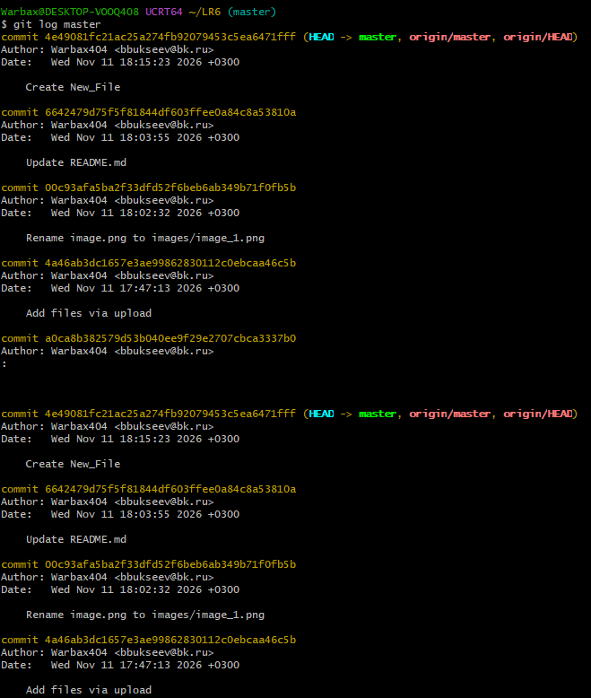
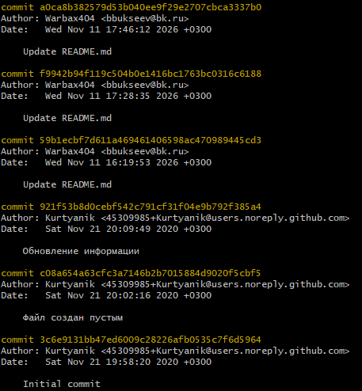
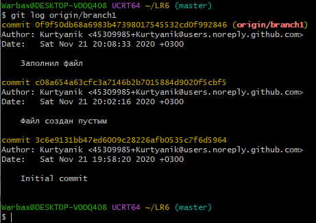
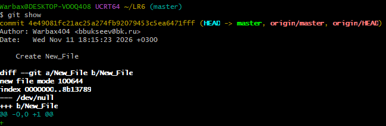

# Лабораторная работа №6
## Выполнил: Буксеев Б.Д.

**Тема:** Система контроля версий Git

**Цель:** изучение базовых возможностей системы управления версиями, получение опыта работы с Git, с локальным и удалённым репозиторием.

## Ход работы

### 1. Создание аккаунта и форк репозитория
После регистрации на GitHub (имя аккаунта – `Warbax404`) был выполнен форк репозитория по ссылке https://github.com/Kurtyanik/LR6/. В профиле появилась папка `Warbax404/LR6`.

### 2. Установка и настройка Git
Далее был установлен Git с сайта https://git-scm.com/. После установки в терминале Git были заданы имя пользователя и почта при помощи команд:
```
git config --global user.name "4515 Буксеев Б.Д."
git config --global user.email "bbukseev@bk.ru"
```
Настройки отображаются корректно, что видно при вводе команды `git config --global --list`  (рис. 1).

<p align="center">
  <br>
  Рисунок 1 — Проверка корректности настроек
</p>

### 3. Копирование репозитория
Форк был скопирован на компьютер, установлена папка репозитория при помощи команд:
```
git clone https://github.com/Warbax404/LR6.git
cd LR6
```

### 4. Создание файла
Создан файл `New_File` и сохранён в главную ветку.
Далее изменения были подтянуты в локальный репозиторий при помощи
```
git pull
```

Далее работа проводилась локально.

### 5. История операций
Была получена история операций (рис. 2-4) и последние изменение (рис. 5) при помощи команд
```
git log master
git log origin/branch1
git show
```

<p align="center">
  <br>
  Рисунок 2 — История операций master
</p>
<p align="center">
  <br>
  Рисунок 3 — История операций master
</p>
<p align="center">
  <br>
  Рисунок 4 — История операций branch1
</p>
<p align="center">
  <br>
  Рисунок 5 — Последние изменения
</p>

### 5. Слияние веток
Локально была установлена ветка branch1, переключение обратно на master:
```
git checkout branch1
git checkout master
```
Далее была выполнена попытка слияния веток при помощи
```
git merge branch1
```
Однако, в терминале появился конфликт (рис. 6).
