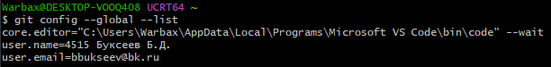

# Лабораторная работа №6
## Выполнил: Буксеев Б.Д.

**Тема:** Система контроля версий Git

**Цель:** изучение базовых возможностей системы управления версиями, получение опыта работы с Git, с локальным и удалённым репозиторием.

## Ход работы

### 1. Создание аккаунта и форк репозитория
После регистрации на GitHub (имя аккаунта – `Warbax404`) был выполнен форк репозитория по ссылке https://github.com/Kurtyanik/LR6/. В профиле появилась папка `Warbax404/LR6`.

### 2. Установка и настройка Git
Далее был установлен Git с сайта https://git-scm.com/. После установки в терминале Git были заданы имя пользователя и почта при помощи команд:
```
git config --global user.name "4515 Буксеев Б.Д."
git config --global user.email "bbukseev@bk.ru"
```
Настройки отображаются корректно, что видно при вводе команды `git config --global --list`  (рис. 1).

<p align="center">
  <br>
  Рисунок 1 — Проверка корректности настроек
</p>
